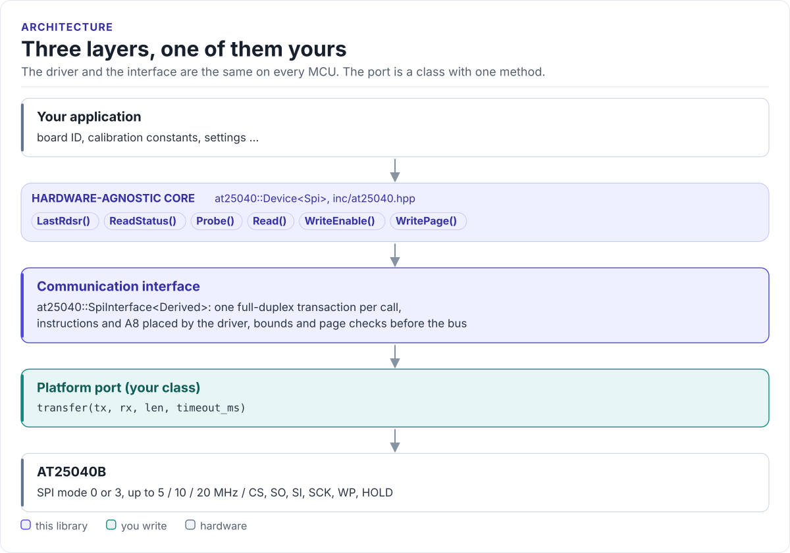

# AT25040 Driver

A header-only C++17 driver for the Microchip AT25040B serial EEPROM (also AT25010B and AT25020B): detect the chip
safely, read and write it in pages, from any MCU with SPI.

[](https://github.com/hardfoc/hf-at25040-driver/actions/workflows/ci-host-tests.yml)
[](https://github.com/hardfoc/hf-at25040-driver/actions/workflows/esp32-examples-build-ci.yml)
[](https://hardfoc.github.io/hf-at25040-driver/)
[](LICENSE)

**Documentation: <https://hardfoc.github.io/hf-at25040-driver/>**

<!-- figure: driver-layers -->
<picture>
  <source media="(prefers-color-scheme: dark)" srcset="docs/diagrams/driver-layers.dark.svg">
  
</picture>
<!-- /figure -->

## In 30 seconds

Write a one-method port class for your MCU (an SPI transaction with CS held low;
[Porting](https://hardfoc.github.io/hf-at25040-driver/latest/porting/)), then:

<!-- generated: quickstart-code -->
```cpp
#include "at25040.hpp"

int store_and_read_back(MySpi& spi) {
  at25040::Device<MySpi> eeprom(spi);

  if (eeprom.Probe() != at25040::Status::Ok) { // 1. a chip is there and idle
    return -1;                                 // wiring, CS, power or SPI mode
  }

  const uint8_t serial[4] = {0x12, 0x34, 0x56, 0x78};
  if (eeprom.WritePage(0x010, serial, sizeof(serial)) != at25040::Status::Ok) { // 2. one page,
    return -2; // 3. and its write cycle: WritePage() returns when the chip is ready again
  }

  uint8_t back[4] = {}; // 4. read it back
  if (eeprom.Read(0x010, back, sizeof(back)) != at25040::Status::Ok) {
    return -4;
  }
  return back[0] == serial[0] ? 0 : -5;
}
```
<!-- /generated -->

## What it does

- Detects the chip with a double status read that rejects a floating or looped-back bus (`Probe()`).
- Reads up to 16 bytes and writes up to one 8-byte page per call, with A8 placed in the opcode for `0x100`-`0x1FF`.
- Checks pointers, lengths, ranges and page crossings before anything goes on the bus.
- Exposes the status register for write-cycle polling and block protection (`ReadStatus()`).
- No heap, no exceptions, no RTOS, no virtual calls (the port is a CRTP class).

## Install

```bash
git submodule add https://github.com/hardfoc/hf-at25040-driver.git external/hf-at25040-driver
```

```cmake
add_subdirectory(external/hf-at25040-driver)
target_link_libraries(my_app PRIVATE hf_at25040)
```

ESP-IDF: use the component wrapper in [`examples/esp32/components/hf_at25040`](examples/esp32/components/hf_at25040/CMakeLists.txt).
Details: [Installation](https://hardfoc.github.io/hf-at25040-driver/latest/installation/).

## Documentation

| | |
| --- | --- |
| [Quickstart](https://hardfoc.github.io/hf-at25040-driver/latest/quickstart/) | Wire it, write the port, store and read back |
| [Hardware](https://hardfoc.github.io/hf-at25040-driver/latest/hardware/) | Pins, bus settings, timing, write protection |
| [API guide](https://hardfoc.github.io/hf-at25040-driver/latest/api-guide/) | Probe, read, write, wait, handle errors |
| [Protocol](https://hardfoc.github.io/hf-at25040-driver/latest/protocol/) | Instructions, status register, probe decisions |
| [Porting](https://hardfoc.github.io/hf-at25040-driver/latest/porting/) | The SPI interface for your MCU |
| [API reference](https://hardfoc.github.io/hf-at25040-driver/latest/api/) | Doxygen, every class and constant |

The pages are in [`docs/`](docs/index.md).

## Tests

```bash
cmake -S . -B build-host -DHF_AT25040_BUILD_TESTS=ON && cmake --build build-host && ctest --test-dir build-host
```

The host tests run the driver against a model of the chip; the code on the documentation site is compiled by the
same build.

## License

GPL-3.0. See [LICENSE](LICENSE).
