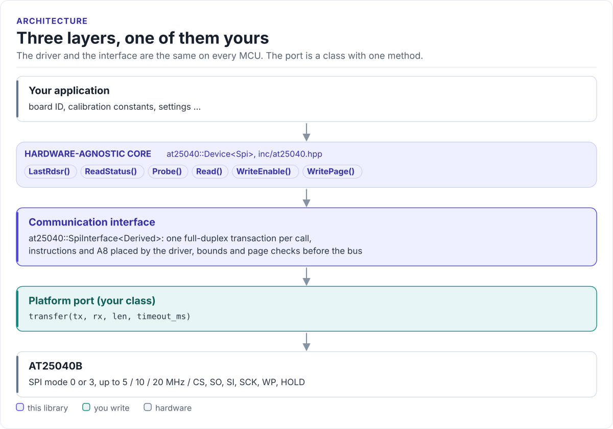
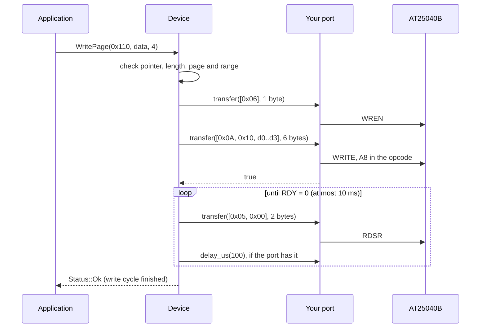

# Architecture

How the driver is put together: three layers, what each owns, and how one call reaches the chip.

<!-- figure: driver-layers -->
<picture>
  <source media="(prefers-color-scheme: dark)" srcset="diagrams/driver-layers.dark.svg">
  
</picture>
<!-- /figure -->

## The three layers

| Layer | Where | You change it |
| --- | --- | --- |
| **Hardware-agnostic core**: `Device<Spi>`, uses only the port's `transfer()` | [`inc/at25040.hpp`](../inc/at25040.hpp), [`inc/at25040_registers.hpp`](../inc/at25040_registers.hpp) | Never, for a new board |
| **Communication interface**: `SpiInterface<Derived>`, one method | [`inc/at25040_spi_interface.hpp`](../inc/at25040_spi_interface.hpp) | Never |
| **Platform port**: your class, on your SDK | Your project | Once per MCU or board ([Porting](porting.md)) |

Everything above the port is the same on ESP32, STM32, a Linux host or the unit-test model. That is how the
[host tests](testing.md) run the real driver code without hardware.

## How one call reaches the chip

Each `transfer()` is one CS-low period, and the driver passes a 20 ms timeout to every transfer. Reads and status
calls are one transfer per 16 data bytes; writes add the status polls of the write cycle.

## Why CRTP

The interface is a class template parameter, not a virtual base class. The compiler sees your port's `transfer()`
(and `delay_us()`, if it has one, detected at compile time) directly and inlines it; the driver has no vtable,
allocates nothing and needs no RTTI. The cost is that the driver type names the port: `Device<MySpi>`. Code that has
to work with several port types takes the driver as a template parameter too.

## Bounded waits, no hidden state

The driver keeps one byte of state: the last status register value (`LastRdsr()`). It does not track the write
cycle, the write-enable latch or the protection level; the chip does, and `ReadStatus()` reads them. The only wait
is the write cycle: a write returns when RDSR shows the chip ready again, or with `Timeout` after
`kWriteCycleTimeoutMs` (10 ms).

## Source map

| Path | Contents |
| --- | --- |
| `inc/at25040.hpp` | `Device<Spi>`, `Status`, `GetAt25040DriverVersion()` |
| `inc/at25040_registers.hpp` | Opcodes, status bits, capacity and page size |
| `inc/at25040_spi_interface.hpp` | `SpiInterface<Derived>`, the CRTP contract |
| `inc/at25040_version.h.in` | Version header template, filled in by CMake |
| `tests/` | Host unit tests, the chip model and the compiled documentation snippets |
| `examples/esp32/` | ESP-IDF application |
