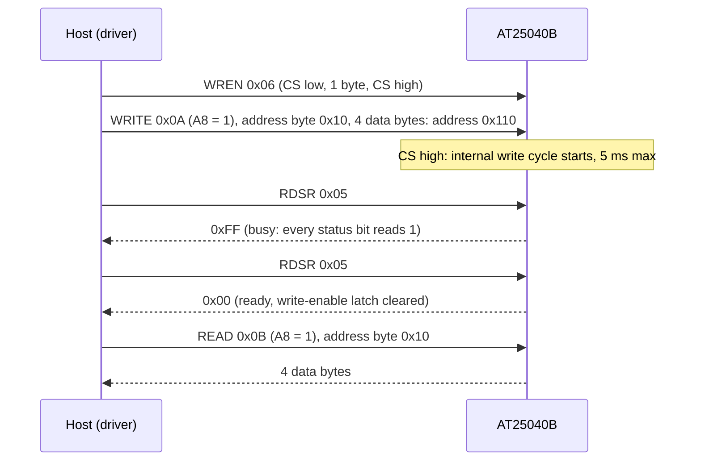

# Hardware

What to connect between your MCU and an AT25040B, with which bus settings, and the board-level details that decide
whether writes stick.

All values here come from the [AT25010B/AT25020B/AT25040B datasheet](https://www.microchip.com/en-us/product/AT25040B)
(Atmel-8707F, 01/2015). When they disagree with a board's schematic, the schematic wins for pin numbers.

## Pins

The 8-lead SOIC and TSSOP use the same pin numbers; the 8-pad UDFN / XDFN and the 8-ball VFBGA number the same
functions 1 to 8.

| Pin | Signal | Notes |
| --- | --- | --- |
| 1 | CS, in | Active low; each instruction starts on its falling edge |
| 2 | SO, out | MISO; high impedance while CS is high |
| 3 | WP, in | Active low; low blocks every write |
| 4 | GND | |
| 5 | SI, in | MOSI |
| 6 | SCK, in | Clock |
| 7 | HOLD, in | Active low; pauses a transfer |
| 8 | VCC | 1.8 V to 5.5 V |

The driver does not drive WP or HOLD. Tie HOLD high. Tie WP high to allow writes, or drive it from a GPIO and hold
it low to make the whole chip read-only in hardware.

## Bus settings

| Setting | Value |
| --- | --- |
| Mode | 0 or 3, MSB first |
| fSCK max | 20 MHz (VCC ≥ 4.5 V), 10 MHz (≥ 2.5 V), 5 MHz (≥ 1.8 V) |
| tCSS, tCSH, tCS min | 100 ns (VCC ≥ 2.5 V), 200 ns (≥ 1.8 V) |
| Frame | Instruction, address (READ, WRITE), data; no dummy bytes |
| tWC max | 5 ms, self-timed, from the CS rising edge |

tCSS is CS setup before the first clock, tCSH CS hold after the last, tCS the CS
high time between instructions.

The opcode carries the ninth address bit (A8) in bit 3 for READ and WRITE on the AT25040B. The driver sets it for
addresses `0x100` to `0x1FF`. [Protocol](protocol.md) has every instruction and the status register.

## Power

| Quantity | Value |
| --- | --- |
| VCC | 1.8 V to 5.5 V; the clock limit depends on it |
| Active current (5 V) | 10 mA max at 20 MHz (read), 3 mA max at 1 MHz |
| Standby current (max, CS high) | 0.5 µA at 1.8 V, 1 µA at 2.5 V, 3.5 µA at 5 V |
| Temperature | -40 °C to +85 °C (industrial grade, H) |

Match VCC to the MCU's I/O voltage: the inputs need VIH of at least 0.7 x VCC. Decouple VCC with
100 nF close to pin 8.

## Write protection

Three mechanisms stop a write; all of them make `WritePage()` look successful while nothing is stored, because the
chip does not report a refused write.

| Mechanism | Effect |
| --- | --- |
| WP pin low (board) | Every write and WREN is ignored |
| Write-enable latch clear (power-up, WRDI, end of every write cycle) | The next WRITE is ignored; `WritePage()` sends WREN first |
| Block protection BP1:BP0 (WRSR, non-volatile) | `01`: `0x180`-`0x1FF`, `10`: `0x100`-`0x1FF`, `11`: all read-only |

[API guide](api-guide.md#status-and-block-protection) shows how to read and set the protection level.

## Sharing the bus

SO is high impedance whenever CS is high, so the AT25040B can share SCK, MOSI and MISO with other SPI devices on
its own chip select. On the Flux analog front-end it sits on the ADS7952 bus as the second device.

## Variants

| Part | Size | Protected by BP = `01` / `10` |
| --- | --- | --- |
| AT25010B | 128 x 8 | `0x60`-`0x7F` / `0x40`-`0x7F` |
| AT25020B | 256 x 8 | `0xC0`-`0xFF` / `0x80`-`0xFF` |
| AT25040B | 512 x 8, A8 in the opcode | `0x180`-`0x1FF` / `0x100`-`0x1FF` |

BP = `11` protects the whole array on every part.

The driver checks addresses against 512 bytes (`kCapacityBytes`). On the smaller parts, keep addresses below 128 or
256 yourself: the chip ignores the upper address bits, so higher addresses alias the start of the array.

## Reference documents

| Document | What it is for |
| --- | --- |
| [AT25010B/AT25020B/AT25040B datasheet](https://www.microchip.com/en-us/product/AT25040B) | Pins, timing, instructions, status register, block protection |
