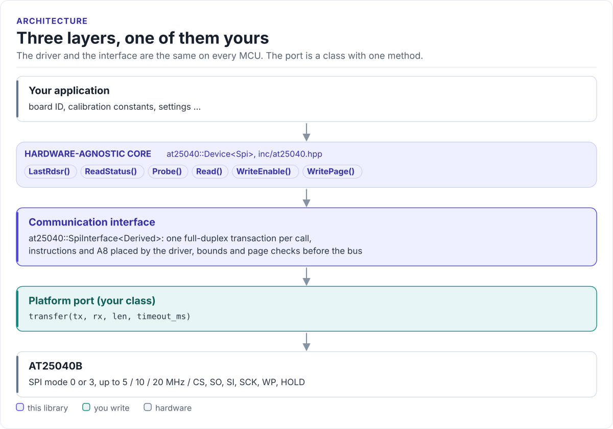

# Porting

Run the driver on a new MCU by writing one class with one method: the SPI transfer.

The driver never calls your SDK directly. It calls `transfer()` on a class you derive from
`at25040::SpiInterface<Self>` (in [`inc/at25040_spi_interface.hpp`](../inc/at25040_spi_interface.hpp)). The base
class uses CRTP: the call is resolved at compile time, so there are no virtual functions, no vtable and nothing to
allocate.

<!-- figure: driver-layers -->
<picture>
  <source media="(prefers-color-scheme: dark)" srcset="diagrams/driver-layers.dark.svg">
  
</picture>
<!-- /figure -->

## What you implement

```cpp
bool transfer(const uint8_t* tx, uint8_t* rx, std::size_t len, uint32_t timeout_ms);
```

| Argument | Contract |
| --- | --- |
| `tx`, `len` | Send `len` bytes in one transaction, CS low for all of them |
| `rx` | Receive `len` bytes: `rx[i]` is the byte clocked in while `tx[i]` went out |
| `timeout_ms` | Give up after this long and return `false` |
| return | `true` when the transaction completed, `false` on a bus error or timeout |

The driver always passes `rx` of the same length as `tx` (at most 18 bytes) and `timeout_ms = 20`.

## SPI port

```cpp title="my_spi.hpp"
--8<-- "tests/docs/my_spi.hpp:port"
```

Rules the transfer must follow:

- **SPI mode 0 or 3**, MSB first, no faster than the chip allows at your VCC: 20 MHz at 4.5 V, 10 MHz at 2.5 V,
  5 MHz at 1.8 V.
- **One transaction per call.** CS goes low before the first byte and high after the last; never split a call into
  two CS periods, never merge two calls. The chip starts a write cycle on the CS rising edge after WRITE.
- **Full duplex.** Fill `rx` with what came back on MISO; `Probe()` and `Read()` read their results from it.
- **Return `false` only for a bus failure.** A missing chip is the driver's job: it shows up as `0xFF` bytes.

## Chip select and shared buses

Drive CS from the SPI peripheral (ESP-IDF `spics_io_num`, STM32 hardware NSS) or toggle a GPIO around the transfer.
On a shared bus, take the bus lock for the whole `transfer()` so another device cannot get between CS low and CS
high. Keep t<sub>CSS</sub>, t<sub>CSH</sub> and t<sub>CS</sub> at 100 ns or more (200 ns at 1.8 V).

## Reference implementation

The ESP32 example's port in
[`at25040_esp32_example.cpp`](../examples/esp32/main/at25040_esp32_example.cpp) is a skeleton: its `transfer()`
returns `false` until you connect it to `spi_device_transmit()` for your board. With ESP-IDF's `spi_master`, one
`spi_transaction_t` with `length = len * 8`, `tx_buffer = tx` and `rx_buffer = rx` on a device configured for mode
0 is the whole port.

## Check your port

1. Build it: the port on this page is compiled by the host CI from [`tests/docs/`](../tests/docs/my_spi.hpp), with
   the driver instantiated over it.
2. Call `Probe()` and log `LastRdsr()`. A ready AT25040B with no protection reads `0x00`; `0xFF` means nothing
   answered.
3. Write one page, wait for WIP to clear, read it back.
4. Read across `0x0FF`/`0x100` in two calls to prove A8 reaches the chip: the two halves must hold different data.

## Threads

The driver is not thread-safe. Give each EEPROM one owner task, or guard every call on a driver object (and its
port) with one mutex. On a shared bus, the bus lock in `transfer()` is not enough for a write followed by a status
poll; hold the mutex for the whole sequence.
